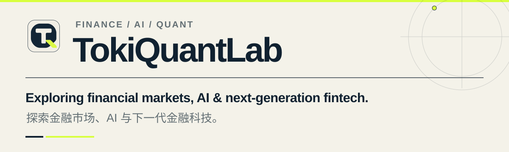
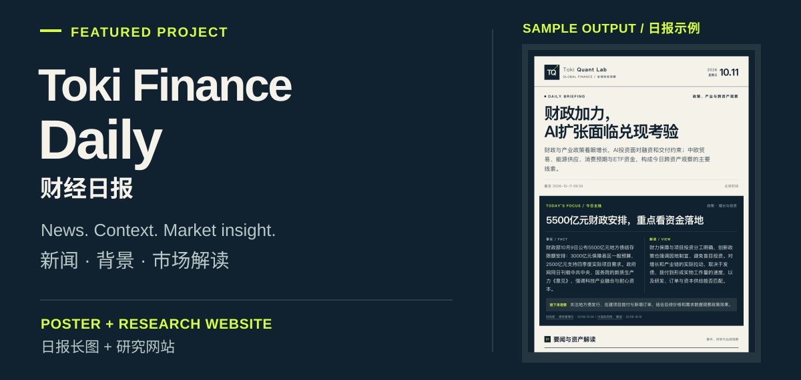

<picture>
  <source media="(max-width: 600px)" srcset="./assets/profile-hero-mobile.svg">
  
</picture>

<h2>About / 关于</h2>

I'm <strong>Toki</strong>. I explore financial markets, practical AI applications, and the tools shaping finance.

我是 <strong>Toki</strong>，关注金融市场、AI 应用与金融科技，记录研究、工具实践与产品探索。

<h2>Focus / 关注方向</h2>

<ul>
  <li><strong>Markets &amp; Research / 市场与研究</strong> Macro, cross-asset relationships, and market data. 宏观变化、跨资产关系与市场数据。</li>
  <li><strong>AI &amp; Quant / AI 与量化</strong> Research workflows, analytical tools, and trading experiments. 研究工作流程、分析工具与交易实践。</li>
  <li><strong>FinTech &amp; On-chain Finance / 金融科技与链上金融</strong> Products, infrastructure, and emerging financial applications. 产品、基础设施与新金融应用。</li>
</ul>

<h2>Selected Work / 代表项目</h2>

<picture>
  <source media="(max-width: 600px)" srcset="./assets/finance-daily-mobile.svg">
  
</picture>

<h3>Toki Finance Daily / 财经日报</h3>

An AI-assisted workflow that turns financial news, macro data, and economic events into a visual daily briefing and a research site.

用 AI 整理财经新闻、宏观数据与重要事件，生成日报长图和完整研究页面。

<code>Python</code> · <code>Agent Skills</code> · <code>HTML/CSS</code>

<h2>Connect / 联系</h2>

<a href="./assets/wechat-qr.png">
  <picture>
    <source media="(max-width: 600px)" srcset="./assets/wechat-contact-mobile.svg">
    
  </picture>
</a>

<a href="./assets/wechat-qr.png">Open QR code / 查看二维码原图</a>

